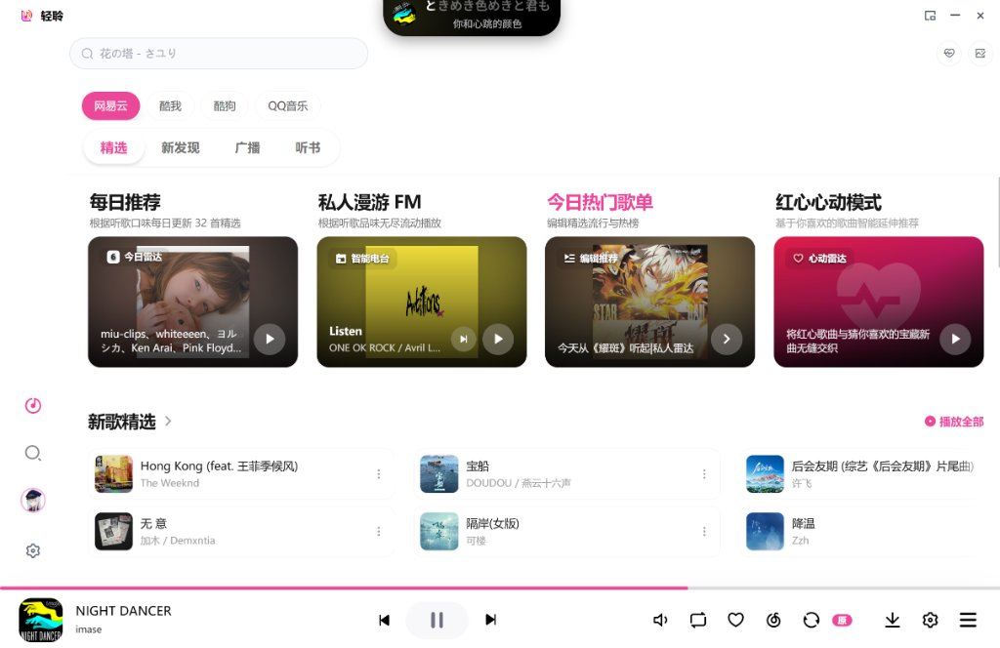
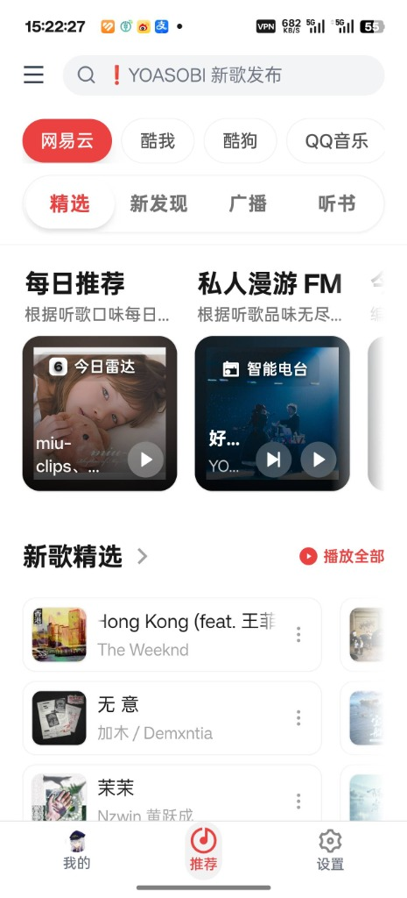

<div align="center">

# 🎵 Lite Music · 轻聆 / 🌸 风见 Kazami

### 网易云音乐第三方客户端 · 极简轻快 / 日语歌词三层逐字对齐 · 电脑 / 手机 / 平板 / Web

[](https://github.com/TerryYu12/lite-music-releases/releases/latest)
[](https://github.com/TerryYu12/lite-music-releases/releases/tag/kazami-v6.1.2)
[](https://github.com/TerryYu12/lite-music-releases/releases)

<p>
  <b>让听歌重回纯净、轻快与沉浸。</b><br/>
  <b>Lite Music</b> 是纯净轻快的第三方网易云音乐客户端，专注于高品质音乐播放与全平台极致体验；<br/>
  <b>风见 Kazami</b> 是其专为东方 Project「风见幽香」定制的主题分支，专门打磨日语歌的三层逐字歌词阅读手感。
</p>

[📥 下载与安装](#-下载与安装) · [🎵 Lite Music 多端特性](#-lite-music-多端特性) · [🌸 风见 Kazami 功能一览](#-风见-kazami-功能一览) · [📱 iPad / Web (PWA) 说明](#-ipad--web-pwa-使用说明) · [📸 风见动态演示与截图](#-风见-kazami-动态演示与截图) · [📜 声明与致谢](#-声明与致谢)

</div>

---

## 📥 下载与安装

| 版本 | 平台 | 适合谁 / 特性亮点 | 下载入口 |
| :--- | :--- | :--- | :--- |
| 💻 **Lite Music** | Windows x64 | 电脑端：桌面悬浮歌词、声屿灵动控制、Mini 迷你模式、全局快捷键、无损播放 | [⬇️ 最新安装包 (.exe)](https://github.com/TerryYu12/lite-music-releases/releases/latest) |
| 📱 **Lite Music** | Android | 移动端：状态栏/手势条全沉浸、后台长效保活、系统媒体中心接管、悬浮歌词 | [⬇️ 最新安装包 (.apk)](https://github.com/TerryYu12/lite-music-releases/releases/latest) |
| 🍎 **Lite Music** | iPad / Web (PWA) | 免安装：Safari 一键添加到主屏幕独立全屏运行、大屏横屏双栏排版、触屏深度优化 | [📖 启动与使用指南](#-ipad--web-pwa-使用说明) |
| 🌻 **风见 Kazami** | Android（手机 / 平板） | 常听日语歌、喜欢好看的幽香主题与三层逐字歌词页 | [⬇️ Kazami-6.1.2.apk](https://github.com/TerryYu12/lite-music-releases/releases/download/kazami-v6.1.2/Kazami-6.1.2.apk) · [更新说明](https://github.com/TerryYu12/lite-music-releases/releases/tag/kazami-v6.1.2) |

- **设备兼容**：Android 7.0 及以上可用，手机和平板通用；Lite Music 标准版和风见分支在同一台设备上**只能装一个**。
- **签名说明**：风见和 Lite Music 正式版签名不同，从 Lite Music 换到风见需要先卸载（本地设置和播放记录会清空，网易云账号里的歌单不受影响）。
- **更新覆盖**：已装过风见版的直接点开新安装包覆盖安装即可，数据保留；5.16 及以后的风见会在应用内自动提示更新（也可在「设置 › 关于」里手动检查）。
- **包名区分**：风见的安装包认准 **`Kazami-版本号.apk`**，在标题为「风见 Kazami」的发布里；Lite Music 发布里的文件是 Lite Music 的。
- **国内加速**：若下载较慢，可复制下载链接，前面加上 `https://ghproxy.cn/`（或 `https://ghproxy.net/`）再打开。
- **开源性质**：本发布仓库仅提供安装包与更新清单，源码维护于私有开发仓库。

---

## 🎵 Lite Music 多端特性

Lite Music 采用跨端内核与现代响应式架构，针对各操作系统提供深度原生与平台级特性支持：

### 💻 1. Windows 桌面端
- **桌面全局悬浮歌词**：支持置顶、锁定、鼠标穿透、单双行轮播切换与卡拉 OK 逐字变色，办公码字时不遮挡视野。
- **声屿（Island）灵动岛**：停靠于屏幕顶部的胶囊控制浮窗，悬停展开歌曲封面、当前曲目、播放进度与切歌控制。
- **Mini 迷你模式**：独立紧凑小窗停靠在屏幕边缘，不占桌面宝贵空间。
- **全局快捷键与系统托盘**：支持后台全局切歌、静音、红心收藏；关闭窗口可自动最小化到系统托盘常驻后台。
- **本地全格式音频管理**：支持扫描播放 MP3、FLAC、WAV、OGG 等无损音频，自动匹配同名或内嵌 `.lrc` 歌词。

<div align="center">
  
</div>

---

### 📱 2. Android 移动端
- **长效后台保活（Foreground Service）**：结合系统媒体通知服务与原生唤醒锁，彻底摆脱切后台即杀与息屏断音。
- **系统媒体中心卡片**：完全接管系统下拉通知栏与锁屏媒体控制器，支持锁屏大封面展示、上一曲/下一曲、拖拽进度条及快捷收藏。
- **系统级桌面歌词悬浮窗**：画中画级别全局悬浮窗，在运行其他应用（微信、游戏、浏览器）时随时悬浮展示实时歌词。
- **全屏全沉浸视口**：状态栏与手势虚拟按键全透明沉浸，智能计算异形屏与挖孔屏避让安全区。
- **应用内版本检查**：在「设置 › 关于」中一键检测最新 APK，支持直连极速镜像覆盖更新。

<div align="center">
  
</div>

---

### 🍎 3. iOS / iPadOS 端（Web PWA）
- **免证书、免越狱、永不掉签**：基于 Web PWA 标准，通过 iPad / iPhone 自带 Safari 访问同源部署服务，点击“分享 → 添加到主屏幕”立享独立全屏应用体验，彻底告别 7 天免费开发者证书掉签烦恼。
- **iPadOS 横屏双栏排版**：大屏平板模式下自动激活响应式双栏，左侧大封面控制器、右侧大幅三层逐字歌词，触控与视觉空间充分释放。
- **安全区（Safe Area）精准避让**：独立全屏模式下毛玻璃底色自然沉底延伸，播放进度与操作按钮自动垫高避让 Home Indicator，上划多任务手势绝不误触播放条。
- **触屏深度手感调教**：消除 Safari 300ms 触控响应延迟，禁用双击误触缩放，移除点击高亮灰色遮罩，长按与点选对齐原生触控直觉。

> 💡 *（iOS / iPadOS 真机实操与独立视口截图后续补齐）*

---

## 🌸 风见 Kazami 功能一览

风见在 Lite Music 的全部功能之上，重做了视觉、歌词排版和手机 / 平板手感。下面按用途分组列出风见的主要功能。

> 🌻 **最新版 6.1.2 · 6.x 亮点**　[⬇️ 下载 Kazami-6.1.2.apk](https://github.com/TerryYu12/lite-music-releases/releases/download/kazami-v6.1.2/Kazami-6.1.2.apk)
>
> - **卡拉 OK 整字点亮**：唱到的字缓缓亮起、轻轻上浮，背后柔光淡入；长音上绽放一圈向日葵花瓣光环。
> - **封面动态取色 / 跟随壁纸取色**：歌名、歌手和全部歌词颜色从专辑封面取，主题色从壁纸取，换歌换壁纸自动跟着变。
> - **换行更顺**：平板 144Hz 实测，逐字歌词换行时的帧数提高到原来的两倍多；歌词只渲染屏幕附近的行，长歌词、三层歌词也不吃力。
> - **低配设备模式**：车机、老款手机一键减负，开启后各项仍可单独调回，关闭即恢复原设置。
> - **更多音源**：接入 QQ 音乐、酷狗（含概念版）、酷我，歌单打开后一次加载完整，评论统一显示。
> - **新装更好看**：默认歌词字号加大 50%，沉浸歌词、聚焦当前行、三层歌词开箱即用。

### 🎨 幽香主题

- **日光花田 / 黄昏花田**：浅色、深色两套暖色调界面，跟随系统自动切换。
- **向日葵播放键**、透明底向日葵图标。
- **内置资源圆体**（开箱即用，不用联网下载）；也可以在设置里导入自己的字体（ttf / otf / woff）。
- **主文字 / 副文字 / 主题色**：浅色、深色主题分别自定义。

### 🈁 日语歌词三层排版

- **上振假名、中原文、下罗马音，逐字对齐**：每个汉字头上标读音，罗马音贴在对应的字下面，跟着歌词一起高亮。
- **对齐算法专门打磨过**：括号和声「（ラララ）」、长音 ō、促音 kitto、连续汉字「2人」、原文自带的括号注音「夢（ゆめ）」都能对上；实在对不上时整行显示罗马音，不会乱对。
- **翻译、罗马音、振假名字号分别可调**，跟着主歌词等比缩放。
- **双语 / 三语歌词自动合并**：同一时间的多行会自动并成「原文 + 罗马音 / 翻译」，本地歌词文件也一样。
- **逐字卡拉 OK**可以开关：唱到的字整字点亮、轻轻上浮，长音上有向日葵花瓣光环；翻译整行跟着当前句高亮。

### 📖 歌词阅读手感

- **聚焦模式**：当前句放大、其他句淡化，换行时整屏像波浪一样错落滚动；放大倍率、淡化程度都可调。
- **沉浸歌词**：进入歌词页 1 秒后，按钮、歌名、歌手全部淡出，歌词铺满全屏，当前句停在屏幕视觉中心；手指按住歌词时控件回来，点任意位置（包括歌词）回到封面。可在播放设置里关闭。
- **滑动歌词跟手**：上下拖动走系统原生滚动，不卡顿；点右侧「▶ 时间」才跳到那一句，不会误触跳进度。
- **字号、行距（0.8–4.0）可调**；「纯音乐，请欣赏」这类单行歌词居中显示。
- **手机竖屏左对齐阅读、歌名置顶**；平板显示侧边快捷栏（音 / 译开关、字号、行距）。

### 🖍️ 歌词配色与描边

- **14 套配色预设**：幽香系列 6 套（向日葵花田、红格洋伞、月下花田、四季·春樱、梦幻馆等，各有日光 / 黄昏两版）+ 背景适配 8 套（高对比白字 / 黑字、霓虹、暖金、歌词底板等）。
- **五种颜色单独自定义**：已唱原文、未唱原文、振假名、罗马音、翻译；歌名、歌手也能单独换色。
- **描边**：粗细连续可调、深浅单独调、颜色自选；歌名和歌手也跟着描边。复杂壁纸、视频壁纸上也看得清。
- **统一取色器**：二维色盘 + 色相 + 透明度 + HEX 色号 + 常用色 / 最近用过，所有调颜色的地方都是同一个。

### 💿 播放页

- **黑胶 / 大封面一键切换**：旋转黑胶带唱臂起落动画，或者大幅专辑封面。
- **封面大小 60%–130% 可调**。
- **平板横屏双栏**：左边封面和控制，右边大字歌词。
- **封面页点任意空白处进入歌词**；超长歌名、歌手自动横向滚动。
- **全面屏沉浸**：内容延伸到状态栏和手势条下面，挖孔屏自动避让。

### 🖼️ 壁纸与透明度

- **图片 / 视频壁纸**：支持 4K 高帧率视频，循环衔接处平滑过渡不闪黑；原图无损保存。
- **全局透明度与模糊度**：卡片 / 背景板、弹出面板两组分别调，都能调到全透明、0 模糊；搜索栏、底部播放栏、设置页、输入框都跟着变。
- **透明边框开关**：全透明时给每个框描一圈细边，照样分得清。
- **「按钮与卡片也透明」开关**、**账号背景透明模式**：让壁纸完整透出来。

### 📂 本地音乐

- **指定文件夹，或一键扫描手机里的全部音乐**；支持 mp3 / flac / wav / ogg / opus / m4a / m4b / aac。
- **本地歌曲自动找歌词**，依次查找：
  1. 同名 `.lrc`（和歌曲放在同一文件夹，UTF-8 / GBK 都能认）
  2. 音频文件自带的歌词（mp3 / flac / m4a，带不带时间戳都行）
  3. 按歌名 + 歌手 + 时长联网搜索（网易云 → QQ 音乐 → 酷狗），对不上的同名歌不会乱用

  搜到的结果会记住，同一首不再重复搜。

### 🎶 歌单与播放

- **大歌单完整可用**：几千首的歌单也会在后台补全，搜索能搜到每一首，随机播放、播放全部覆盖整个歌单。
- **记得你听到哪**：重启后恢复上一首、播放列表和进度。
- **流畅**：平板实测（144Hz 屏、4K 60 帧视频壁纸）整体约 140 帧，视频壁纸 59 帧；逐字歌词换行时 1.25 秒内约 115–150 帧，普通歌词换行接近满帧。个别设备上逐字滚动卡顿时，可把系统屏幕刷新率调到 60Hz。
- **低配设备模式**（设置 › 外观）：给车机、老款处理器用，关掉毛玻璃、歌词模糊和描边，逐字歌词只保留变色；各项仍可单独打开，关闭即恢复开启前的设置。
- **独立更新通道**：只提示风见自己的新版本，不会被 Lite Music 的版本打扰。

---

## 📱 iPad / Web (PWA) 使用说明

针对 iPad 用户与不便安装原生客户端的场景，Lite Music 提供了开箱即用的 Web / PWA 同源部署方案：

### 1. 启动服务（局域网 / 个人服务器）
在电脑或 NAS 上拉取本项目后运行：
```bash
# 构建并启动同源服务（集成接口代理与静态托管）
pnpm run build:mobile
pnpm run serve:web

# 可选：配置证书以 HTTPS 启动（保障 iOS 锁屏 MediaSession 媒体卡片完整激活）
node scripts/serve-web.mjs --ssl-key ./key.pem --ssl-cert ./cert.pem
```
控制台会输出本地及局域网访问地址（如 `http://192.168.x.x:4173`）。

### 2. iPad Safari 添加至主屏幕
1. 用 iPad 上的 **Safari 浏览器** 打开上述局域网地址；
2. 点击 Safari 分享按钮，选择 **“添加到主屏幕”**；
3. 从桌面图标启动，即可享受**无地址栏、无底栏的纯净独立全屏体验**，自动适配 iPad 大屏双栏排版与触屏手势。

---

## 📸 风见 Kazami 动态演示与截图

### 黑胶唱片与三层歌词

<div align="center">
  
</div>

### 黑胶 / 大封面切换

<div align="center">
  
</div>

### 中日双语歌词

<div align="center">
  
</div>

### 平板横屏双栏

<div align="center">
  
</div>

### 发现页与歌单

<div align="center">
  
  
</div>

---

## 📜 声明与致谢

- Lite Music 基于开源项目 [AlgerMusicPlayer](https://github.com/algerkong/AlgerMusicPlayer) 二次开发，原项目许可见 [LICENSE-AlgerMusicPlayer.txt](LICENSE-AlgerMusicPlayer.txt)。
- 风见幽香及东方 Project 相关角色版权归上海爱丽丝幻乐团（ZUN）所有，风见 Kazami 仅以同人方式致敬，与官方无关。
- 本软件是第三方客户端，与网易云音乐官方无隶属关系，仅供学习交流，禁止商用。请多支持正版音乐。
