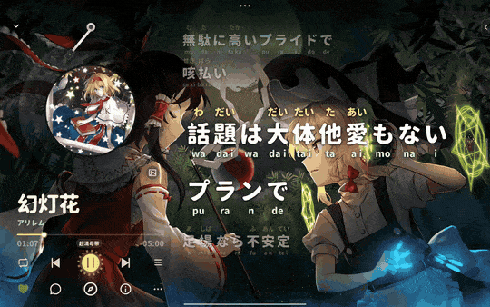
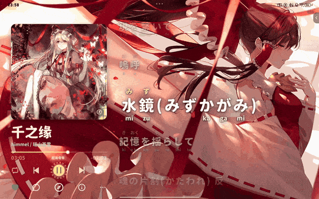
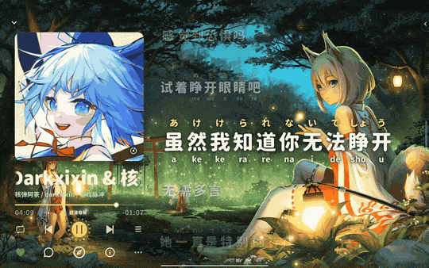
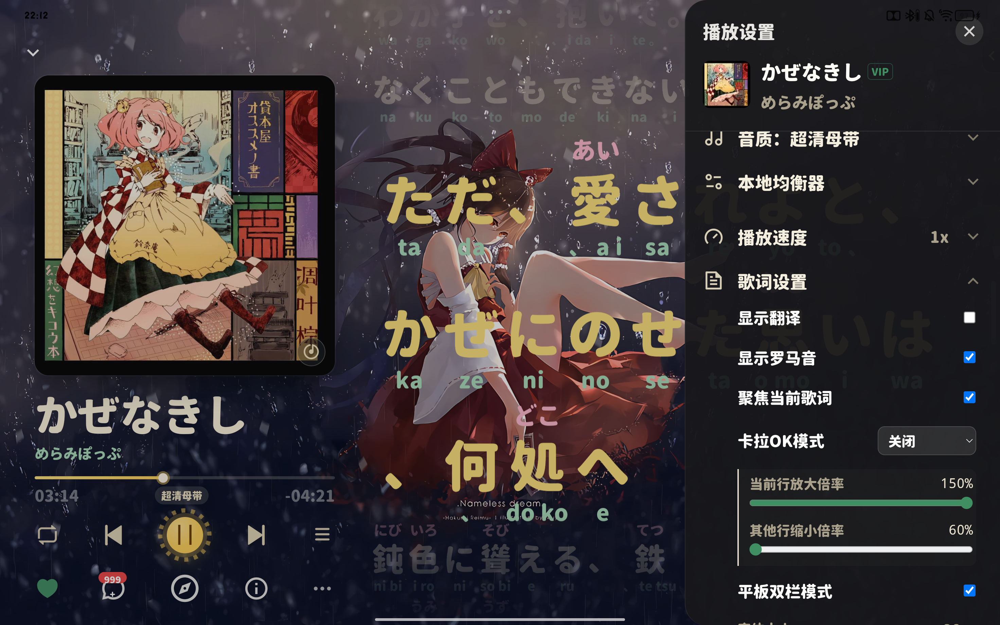
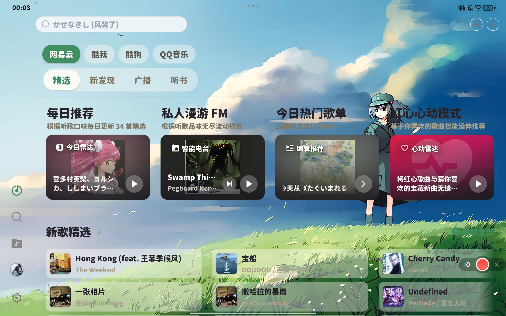
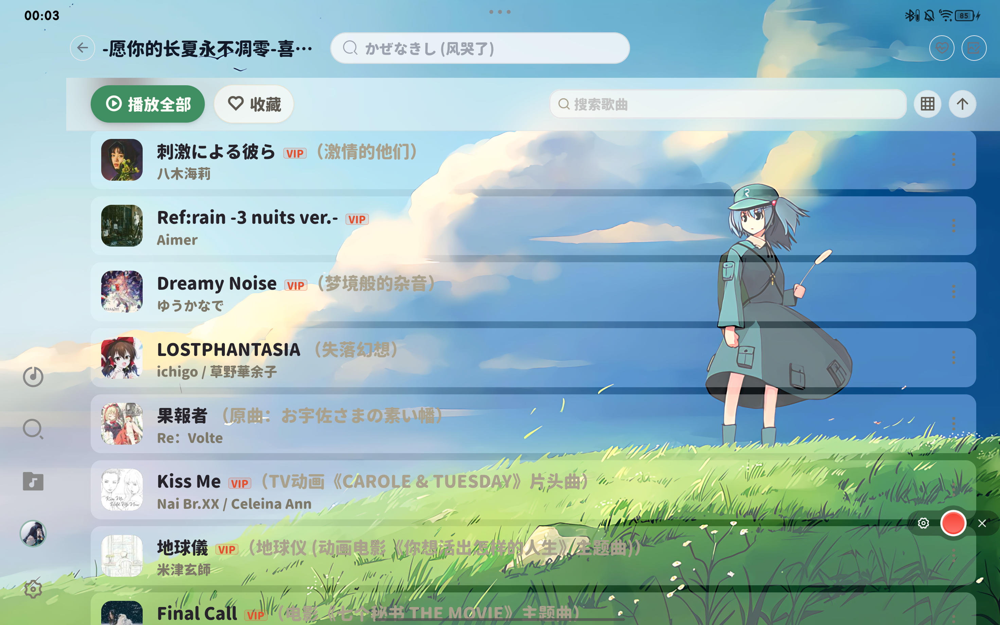

# 🌻 Lite Music · 风见 Kazami

### 网易云音乐第三方客户端 · 日语歌词三层逐字对齐 · 手机 / 平板 / 电脑

  <b>让音乐像掠过花田的风。</b> 
  Lite Music 是轻快好用的网易云音乐客户端；风见 Kazami 是它的主题版， 
  以东方 Project「风见幽香」为灵感重做了整套视觉，专门打磨日语歌的歌词阅读。

[📥 下载安装](#-下载安装) · [🌸 风见功能一览](#-风见-kazami-功能一览) · [📸 截图](#-截图)

---

## 📥 下载安装

| 版本 | 平台 | 适合谁 | 下载 |
| :--- | :--- | :--- | :--- |
| 🎵 **Lite Music** | Android | 想要轻量、纯净听歌体验 | [最新版](https://github.com/TerryYu12/lite-music-releases/releases/latest) |
| 💻 **Lite Music** | Windows x64 | 电脑端：桌面歌词、全局快捷键、悬浮窗 | [最新版](https://github.com/TerryYu12/lite-music-releases/releases/latest) |
| 🌻 **风见 Kazami** | Android（手机 / 平板） | 常听日语歌、喜欢好看的歌词页 | [⬇️ Kazami-6.0.3.apk](https://github.com/TerryYu12/lite-music-releases/releases/download/kazami-v6.0.3/Kazami-6.0.3.apk) · [更新说明](https://github.com/TerryYu12/lite-music-releases/releases/tag/kazami-v6.0.3) |

- Android 7.0 及以上可用，手机和平板通用；Lite Music 和风见在同一台手机上**只能装一个**。
- 风见和 Lite Music 正式版签名不同，从 Lite Music 换到风见需要先卸载（本地设置和播放记录会清空，网易云账号里的歌单不受影响）。
- 已装过风见版的，直接点开新安装包覆盖安装即可，数据保留；5.16 及以后的风见会在应用内自动提示更新（也可以在「设置 › 关于」里手动检查）。
- 风见的安装包认准 **`Kazami-版本号.apk`**，在标题为「风见 Kazami」的发布里；Lite Music 发布里的文件是 Lite Music 的。
- 下载慢可以复制下载链接，前面加上 `https://ghproxy.net/` 再打开。
- 本页只提供安装包和更新清单，不包含源码。

---

## 🌸 风见 Kazami 功能一览

风见在 Lite Music 的全部功能之上，重做了视觉、歌词排版和手机 / 平板手感。下面按用途分组列出风见的主要功能。

### 🎨 幽香主题

- **日光花田 / 黄昏花田**：浅色、深色两套暖色调界面，跟随系统自动切换。
- **向日葵播放键**、透明底向日葵图标。
- **内置资源圆体**（开箱即用，不用联网下载）；也可以在设置里导入自己的字体（ttf / otf / woff）。
- **主文字 / 副文字 / 主题色**：浅色、深色主题分别自定义。

### 🈁 日语歌词三层排版

- **上振假名、中原文、下罗马音，逐字对齐**：每个汉字头上标读音，罗马音贴在对应的字下面，跟着歌词一起高亮。
- **对齐算法专门打磨过**：括号和声「（ラララ）」、长音 ō、促音 kitto、连续汉字「2人」、原文自带的括号注音「夢（ゆめ）」都能对上；实在对不上时整行显示罗马音，不会乱对。
- **翻译、罗马音、振假名字号分别可调**，跟着主歌词等比缩放。
- **双语 / 三语歌词自动合并**：同一时间的多行会自动并成「原文 + 罗马音 / 翻译」，本地歌词文件也一样。
- **逐字卡拉 OK 高亮**可以开关。

### 📖 歌词阅读手感

- **聚焦模式**：当前句放大、其他句淡化，换行时整屏像波浪一样错落滚动；放大倍率、淡化程度都可调。
- **沉浸歌词**：进入歌词页 1 秒后，按钮、歌名、歌手全部淡出，歌词铺满全屏，当前句停在屏幕视觉中心；手指按住歌词时控件回来，点任意位置（包括歌词）回到封面。可在播放设置里关闭。
- **滑动歌词跟手**：上下拖动走系统原生滚动，不卡顿；点右侧「▶ 时间」才跳到那一句，不会误触跳进度。
- **字号、行距（0.8–4.0）可调**；「纯音乐，请欣赏」这类单行歌词居中显示。
- **手机竖屏左对齐阅读、歌名置顶**；平板显示侧边快捷栏（音 / 译开关、字号、行距）。

### 🖍️ 歌词配色与描边

- **14 套配色预设**：幽香系列 6 套（向日葵花田、红格洋伞、月下花田、四季·春樱、梦幻馆等，各有日光 / 黄昏两版）+ 背景适配 8 套（高对比白字 / 黑字、霓虹、暖金、歌词底板等）。
- **五种颜色单独自定义**：已唱原文、未唱原文、振假名、罗马音、翻译；歌名、歌手也能单独换色。
- **描边**：粗细连续可调、深浅单独调、颜色自选；歌名和歌手也跟着描边。复杂壁纸、视频壁纸上也看得清。
- **统一取色器**：二维色盘 + 色相 + 透明度 + HEX 色号 + 常用色 / 最近用过，所有调颜色的地方都是同一个。

### 💿 播放页

- **黑胶 / 大封面一键切换**：旋转黑胶带唱臂起落动画，或者大幅专辑封面。
- **封面大小 60%–130% 可调**。
- **平板横屏双栏**：左边封面和控制，右边大字歌词。
- **封面页点任意空白处进入歌词**；超长歌名、歌手自动横向滚动。
- **全面屏沉浸**：内容延伸到状态栏和手势条下面，挖孔屏自动避让。

### 🖼️ 壁纸与透明度

- **图片 / 视频壁纸**：支持 4K 高帧率视频，循环衔接处平滑过渡不闪黑；原图无损保存。
- **全局透明度与模糊度**：卡片 / 背景板、弹出面板两组分别调，都能调到全透明、0 模糊；搜索栏、底部播放栏、设置页、输入框都跟着变。
- **透明边框开关**：全透明时给每个框描一圈细边，照样分得清。
- **「按钮与卡片也透明」开关**、**账号背景透明模式**：让壁纸完整透出来。

### 📂 本地音乐

- **指定文件夹，或一键扫描手机里的全部音乐**；支持 mp3 / flac / wav / ogg / opus / m4a / m4b / aac。
- **本地歌曲自动找歌词**，依次查找：
  1. 同名 `.lrc`（和歌曲放在同一文件夹，UTF-8 / GBK 都能认）
  2. 音频文件自带的歌词（mp3 / flac / m4a，带不带时间戳都行）
  3. 按歌名 + 歌手 + 时长联网搜索（网易云 → QQ 音乐 → 酷狗），对不上的同名歌不会乱用

  搜到的结果会记住，同一首不再重复搜。

### 🎶 歌单与播放

- **大歌单完整可用**：几千首的歌单也会在后台补全，搜索能搜到每一首，随机播放、播放全部覆盖整个歌单。
- **记得你听到哪**：重启后恢复上一首、播放列表和进度。
- **流畅**：平板实测（144Hz 屏、4K 60 帧视频壁纸）整体约 140 帧，歌词滚动全程满帧，视频壁纸 59 帧。
- **独立更新通道**：只提示风见自己的新版本，不会被 Lite Music 的版本打扰。

---

## 📸 截图

### 黑胶唱片与三层歌词

  

### 黑胶 / 大封面切换

  

### 中日双语歌词

  

### 平板横屏双栏

  

### 发现页与歌单

  
  

---

## 📜 声明与致谢

- Lite Music 基于开源项目 [AlgerMusicPlayer](https://github.com/algerkong/AlgerMusicPlayer) 二次开发，原项目许可见 [LICENSE-AlgerMusicPlayer.txt](LICENSE-AlgerMusicPlayer.txt)。
- 风见幽香及东方 Project 相关角色版权归上海爱丽丝幻乐团（ZUN）所有，风见 Kazami 仅以同人方式致敬，与官方无关。
- 本软件是第三方客户端，与网易云音乐官方无隶属关系，仅供学习交流，禁止商用。请多支持正版音乐。
